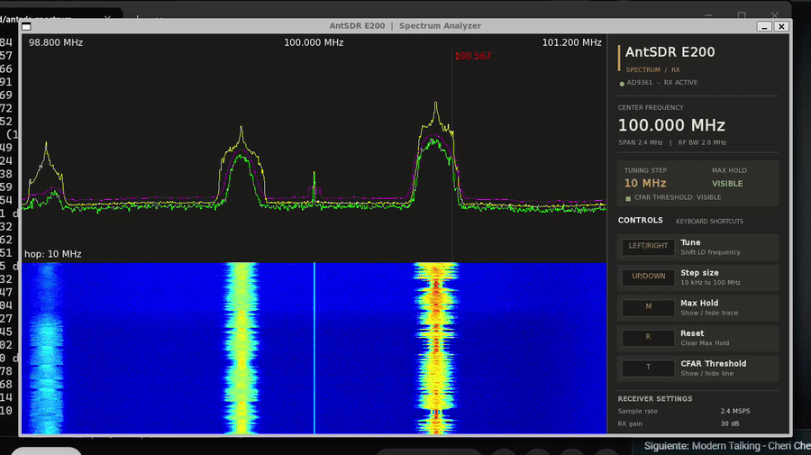

# AntSDR E200 Spectrum Analyzer




A small real-time spectrum analyzer for the **AntSDR E200 (AD9361)**, written in **C++17** with libiio 1.x, FFTW3, and SFML 2.x. The interface features a graphite-colored sidebar, a live spectrum, a waterfall, Max Hold, and an experimental CA-CFAR detector.

> **Status:** Development project. Detection widths are CFAR cluster widths, not calibrated occupied bandwidths. Displayed power is **uncalibrated** and is **not dBm or dBFS**.

## Features

- Receive and tune IQ samples over an IIO URI (default `ip:192.168.1.10`)
- 1024-point Hann-windowed FFT; average power across 64 non-overlapping windows per 65,536-sample block
- Frequency-shifted spectrum, waterfall and persistent Max Hold
- CA-CFAR threshold/detection overlays and merged signal markers
- Keyboard tuning with configurable frequency step
- Graphite/ivory/ochre sidebar with live receiver status

## Build (Linux)

Requirements: a C++17 compiler, CMake, pkg-config, **libiio 1.x**, **FFTW3** and **SFML 2.5/2.6** (not SFML 3). Install the development packages for your distribution, plus DejaVu or Liberation fonts for UI labels. Ensure `pkg-config --modversion libiio` and `pkg-config --modversion fftw3` return versions.

```sh
cmake -S . -B build -DCMAKE_BUILD_TYPE=Release
cmake --build build -j
./build/antsdr_spectrum ip:192.168.1.10
```

To use another IIO URI, pass it as the first argument. To run the DSP-independent CFAR test:

```sh
ctest --test-dir build --output-on-failure
```

## Controls

| Key | Function |
| --- | --- |
| Left / Right | Tune RX center frequency down / up |
| Up / Down | Increase / decrease tuning step |
| M | Toggle Max Hold visibility |
| R | Reset Max Hold |
| T | Toggle CFAR threshold line |

## Project layout

```text
include/Config.hpp              Hardware/UI constants
include/Types.hpp               IQ samples, spectrum, detection types
include/SdrReceiver.hpp         libiio hardware interface
include/SpectrumProcessor.hpp   Hann, FFTW, power averaging, Max Hold
include/CfarDetector.hpp        CA-CFAR and detection grouping
include/SpectrumRenderer.hpp    SFML spectrum, waterfall and sidebar
include/Application.hpp         Event loop / orchestration
src/                            Implementation files and main.cpp
tests/test_cfar.cpp             Hardware-free CFAR smoke test
```

## Hardware assumptions

- `ad9361-phy` exposes the receiver controls and `cf-ad9361-lpc` exposes the streaming samples.
- `voltage0` and `voltage1` are enabled as I and Q, respectively.
- The stream is assumed to contain **interleaved signed 16-bit little-endian I/Q**, exactly 4 bytes per complex sample. The code rejects unexpected sample strides but **does not yet check the channel data-format metadata**. Verify the format of your actual firmware/device with `iio_info` before relying on numeric amplitude values.
- Frequency settings and gain must be supported by the device. A failed libiio operation is treated as an error.
- The example assumes a desktop Linux GUI with SFML 2.x and an SDR reachable over IP. It is not tested here with physical SDR hardware.

## Technical notes

- Each FFT is 1024 samples; 65,536 / 1024 = 64 spectra per full receive block.
- Bin spacing is `FS / FFT_SIZE = 2343.75 Hz` at the default 2.4 MSPS rate.
- The waterfall's vertical axis is **frames**, not a calibrated clock/time axis.
- CA-CFAR's `ALPHA = 2` is an illustrative threshold multiplier, **not** a calibrated false alarm probability.
- Tuning discards four blocks, resets Max Hold and clears the waterfall so old-frequency traces do not appear at the new frequency.
- The sample rate, RF bandwidth, CFAR settings, plots, gain and palette can be changed in `include/Config.hpp` and `src/SpectrumRenderer.cpp`.

## Next steps

- Read IIO channel format descriptors and support non-default sample packing.
- Calibrate the spectrum in dBFS or dBFS/Hz and allow vertical scale adjustment.
- Benchmark and tune CFAR with recorded IQ data, add more unit tests.
- Improve event responsiveness by decoupling blocking IQ reads and rendering.

## License

This project is licensed under the **MIT License**. See [LICENSE](LICENSE) for the full text.
